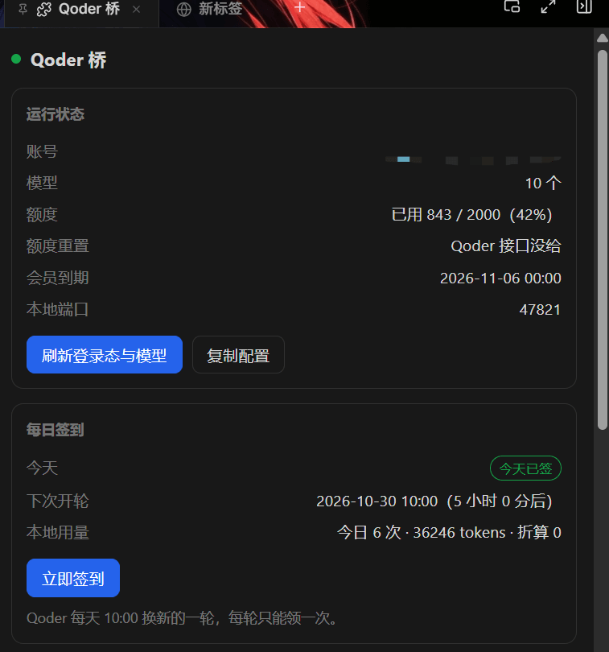
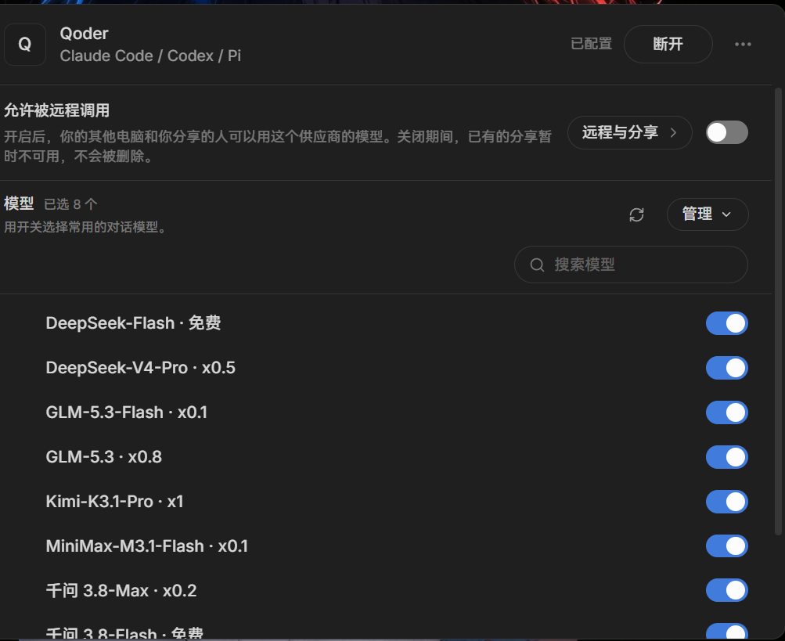

<h1 align="center">cindy-qoder-bridge</h1>

<p align="center"><b>Bring the Qoder CN models you're already signed into onto Cindy — zero config, your own quota.</b></p>

<p align="center">
  English · <a href="README.md">简体中文</a>
</p>

<p align="center">
  <a href="#install">Install</a> ·
  <a href="#how-it-works">How it works</a> ·
  <a href="#what-the-panel-shows">Panel</a> ·
  <a href="CHANGELOG.md">Changelog</a> ·
  <a href="https://github.com/linvisxie/cindy-qoder-bridge/issues">Issues</a>
</p>

<p align="center">
  <a href="https://github.com/linvisxie/cindy-qoder-bridge/releases"></a>
  <a href="LICENSE"></a>
  <a href="https://github.com/linvisxie/cindy-qoder-bridge/stargazers"></a>
  <a href="https://github.com/linvisxie/cindy-qoder-bridge/issues"></a>
  
  
  
</p>

Plug the **Qoder CN** models you're already signed into into [Cindy](https://cindy.chat)
and use your own Qoder quota right from Cindy's model picker — no API key, no extra subscription.

The plugin serves a local endpoint at `127.0.0.1:47821` that speaks three protocols
(OpenAI Chat / Anthropic Messages / OpenAI Responses), so all three Cindy harness
engines (`pi` / `claude-code` / `codex`) can connect.

<p align="center">
  
</p>

The **Qoder bridge** tab in the right sidebar: account and status light, model count,
plan quota, membership expiry, local port — plus a separate **daily check-in** card
showing whether today is claimed, when the next round opens, and how many requests and
tokens you've spent locally today. **Copy config** puts the Base URL and API key on the
clipboard in one go.

The panel only reads Qoder's own endpoints and your local ledger. It will **never**
check in on your behalf — that click is always yours.

Model names carry their price factor (`· Free` / `· x0.2` / `· x1`) so you can see at a
glance which are cheap right in Cindy's provider list:

<p align="center">
  
</p>

## 0.1.21 acceptance and release status (2026-11-11)

Previously unreleased review fixes are included. See GitHub Releases for public release status; publication does not mean local installation. Real Qoder CN user logout immediately cleared the cache on the ordinary read path; user login returned `valid`. Briefly renaming away the real auth file returned `absent`, cleared the cache, and restoration without overwriting succeeded. Real `Local State` remained byte-for-byte unchanged and the final real login was healthy. A temporary copy using the real auth payload and a new Windows-DPAPI-protected AES key passed rotation and key-cache invalidation checks; temporary corruption fallback and VM-local time advancement for expiry also passed. Copies were deleted; no upstream requests were made. **No Windows system master key was changed or rotated, and natural key generation by the real client was not verified.** See the [credential acceptance record](docs/CREDENTIAL-ACCEPTANCE-2026-11-11.md). An independent real-profile reread confirmed valid, unexpired credentials matching the cache, without modifying the real profile or making upstream requests; see the [permanent boolean evidence](docs/credential-acceptance-2026-11-11.json).

## How it works

```
A chat in Cindy
  -> one of OpenAI Chat / Anthropic Messages / OpenAI Responses
  -> http://127.0.0.1:47821/v1        local endpoint started by this plugin (loopback only)
  -> COSY signing + Encode permutation  upstream is not an OpenAI-compatible endpoint
  -> https://gateway.qoder.com.cn/     billed to your own Qoder account
  -> double-wrapped SSE
  -> translated back into the protocol you asked for
```

Qoder is not an OpenAI-compatible endpoint, so three things are needed:

1. **COSY signing headers** — every gateway request carries `Cosy-*` headers and
   `Authorization: Bearer COSY.<payload>.<sig>`.
2. **Permuted base64 request bodies** — `Encode=1` in the query string means the JSON body
   must be base64-encoded, substituted through a swapped alphabet, then rotated in thirds.
3. **Double-wrapped SSE** — each `data:` frame is an envelope object whose `body` field is
   itself a JSON string.

The login state is decrypted fresh from the Qoder CN client's `auth.v1.dat`
(OSCrypt v10 → DPAPI) on each read, **used only in memory, never written to disk**.

Main components:

| File | Role |
|---|---|
| `plugin/main.js` | The brain: forwards AI tool calls and panel requests to the worker |
| `plugin/node/bootstrap.cjs` | Manifest `node.entry` (`node/bootstrap.cjs`): acquires install and data locks before loading any business modules / worker |
| `plugin/node/worker.cjs` | Resident Node process: decrypts login state, serves HTTP, routes three protocols |
| `plugin/node/adapters.cjs` | Protocol translation between Anthropic / Responses and OpenAI Chat |
| `plugin/node/update.cjs` | Pure functions for self-update: version compare, digest check, unzip, script generation |
| `plugin/node/download.cjs` | Update URL, redirect and package-size restrictions |
| `plugin/node/ownership.cjs` | OS-exclusive ownership of the install and runtime data directories |
| `plugin/node/update-status.cjs` | Update journal attempt / result and interrupted-update boot guards |
| `plugin/panel.*` | Right-side panel: account, quota, check-in, model list, Base URL / API key |

It manages its own plugin files and runtime data, **not Cindy's host installation receipt or provider configuration**. Add providers manually in Cindy; see the self-update limitations below.

## Requirements (check each one)

| Dependency | Requirement | Notes |
|---|---|---|
| OS | **Windows 10 / 11** | The one hard limit. Login state is decrypted with Windows DPAPI (`CryptUnprotectData`, via PowerShell); on macOS / Linux that step can't work and the plugin won't start. |
| Cindy client | **≥ 0.1.119** | That's the `minCindyVersion` in the manifest. Older builds have no `custom_providers` and no node worker. |
| Qoder CN client | Installed and **signed in** | China mainland only (client app id `com.qodercn.app.stable`). The international build (`qoder`) is not supported — personal quota there is usually 0. |
| Node.js | **≥ 22** (24 recommended) | Uses `fetch`, `AbortSignal.timeout`, `node:readline`. The worker runs on the Node bundled with Cindy; you only need your own to run the tests. |
| Network | Reachable `gateway.qoder.com.cn` / `openapi.qoder.com.cn` | Assumes a China network environment. |
| Disk | ~100 KB | Plugin itself. Runtime data (logs, usage ledger) is separate, under `%APPDATA%\CindyGlobal\qoder-bridge\`. |

> No API key, no OpenAI / Anthropic account, no extra subscription. It uses the quota your
> own Qoder account already has.

## Install

### 1. Get the package

Download `cindy-qoder-bridge.cindy` from [Releases](../../releases), or build it yourself:

```bat
cd plugin
npm run pack        :: produces dist\cindy-qoder-bridge.cindy
```

A `.cindy` is just a zip (with `ghost.json` at the root). `scripts/pack.cjs` is a
zero-dependency hand-rolled packer — same input, same bytes out.

> **Since 0.1.20, the same commit produces an identical sha256 in any timezone (UTC / UTC+8).**
> The one precondition is that worktree files use LF — `pack.cjs` reads worktree bytes directly
> and does not normalize line endings.
>
> `.gitattributes` guarantees LF on a normal `git checkout`, but **if an editor saves a source
> file with CRLF, a local rebuild will hash differently from the release.** That is not evidence
> of a tampered package — it means your worktree bytes differ from the ones that were packaged.
> Run `git checkout -- .` and rebuild to match. To verify a release package, use
> `SHA256SUMS.txt` from the release page.

### 2. Install into Cindy

Cindy → Plugins → import the `.cindy` (or drag the file in).

The first install lists permissions for you to confirm. It declares a **resident Node
process** — which means **it can read and write files on your machine and reach the
network**. That's required to read Qoder's login state and serve a local endpoint.
Please make sure you're comfortable with that before installing.

### 3. Add the provider in Cindy (the only manual step)

After installing, a **Qoder bridge** tab appears in the right sidebar. It shows
**account / model count / quota / local port / Base URL / API key**, and **Copy config**
copies the Base URL and API key together.

Then: **Cindy Settings → Models → Add custom provider**

| Field | Value |
|---|---|
| Name | Anything, e.g. `Qoder` |
| Base URL | `http://127.0.0.1:47821/v1` (whatever the panel shows) |
| API Key | The token from the panel, exactly as shown |
| Model ID | Pick from the panel list and add them one by one |

**Protocol (by engine — pick wrong and that engine stays disabled):**

| Cindy engine | Required protocol |
|---|---|
| `pi` | Any of the three |
| `claude-code` | **Anthropic Messages** |
| `codex` | **OpenAI Responses** |

This is a hard rule in Cindy (`acceptsWireProtocol`: `claude-code` only accepts
`anthropic-messages`, `codex` only accepts `openai-responses`, `pi` accepts all). This
plugin supports all three.

Per model:

- **Context window**: reports **1,000,000** by default (Qoder's official tiers are
  200K / 400K / 1M, with 200K as the default). Set `CINDY_QODER_CONTEXT=default` to
  report 200K instead.
- **Vision input**: all CN-region models support it — turn it on.
- **Reasoning effort**: exposed in both the panel and `/v1/models` (`high` / `max` /
  `low` and friends). The ones that can be selected show up automatically.

### 4. Afterwards

Just start Cindy normally. The plugin is `resident`, so Cindy pulls the worker up to
`47821` on its own. The token persists in `state.json` and the provider config lives in
Cindy's own database — nothing else to manage.

**These cases need you:**

1. Qoder login expired → sign in again in the Qoder CN client, then hit **Refresh** in the panel.
2. Port `47821` taken by something else → the worker falls through to `47822`… and the
   panel's Base URL changes, so update it in Cindy.
3. Uninstalling and reinstalling the plugin → you'll need to re-enter the provider.
4. After self-update replaces runtime files → import the complete `.cindy` package through Cindy's native UI to refresh the host installation record.

## What the panel shows

- **Login state**: account name, green dot / red dot
- **Quota**: used / total, add-on pack quota, quota expiry, membership expiry
- **Daily check-in**: whether today is claimed, how many credits are available, countdown
  to the next 10:00 round, with a **Check in now** button
- **Today's usage**: requests / tokens / weighted amount (tokens × factor)
- **Model list**: each model's price factor (`· x0.2` / `· Free`) and reasoning efforts
- **Log**: path to `bridge.log` — look here first when something breaks
- **Check for updates**: the button to the right of **Copy config**. One click queries
  GitHub Releases; if there's a new version the button becomes **Install x.y.z** and a
  second click actually installs (the process exits and restarts, hence the two steps).
  Before overwriting it backs up the whole install directory to
  `<dir>.bak-<old version>`.

The AI side can ask too: five tools — `qoder_status`, `qoder_endpoint`, `qoder_refresh`,
`qoder_checkin`, `qoder_update`. Pass `action=apply` to `qoder_update` to download and
install.

## Update safety and runtime boundaries

- Updates require a matching, valid **64-hex-digit SHA-256**; size-only fallback is no longer accepted. Downloads require the exact GitHub HTTPS repo / tag / asset, allowlisted redirect domains, at most 5 redirects and a 32 MiB package limit.
- The installer waits for the old PID to exit and stops without overwriting if it remains alive. After exit, it acquires OS-exclusive locks in the same fixed order, `INSTALL_DIR` (`install`) → `DATA_DIR` (`data`), and holds both throughout installation. After acquiring both locks, the installer validates the attempt identity in `latest-attempt.json`; a late script refuses to copy if the pointer has changed generation or is missing. Each journal attempt / result is persisted. Copy failures trigger rollback, which never overwrites the journal; failed rollback retains diagnostics and backups. `update-status` blocks boot after interrupted copy / rollback; journal `begin` and `applyUpdate` must not overwrite an unrecovered attempt pointer, and `begin` rejects a previous `handed_off` attempt. A pending handoff with no confirmed result blocks a new update: inspect `<install-dir>.updates/attempt-*/install.log` first. Automatic retry is not promised.
- The persistent update directory is `UPDATE_DIR = canonicalDirectory(INSTALL_DIR) + '.updates'`: `<install-dir>.updates`, a sibling of the canonical install directory, not `update/` in the data directory. Bootstrap, worker and installer all check this journal independently of `DATA_DIR`; changing data directories cannot bypass it, and rollback never overwrites it.
- **Recovery requires manual journal handling; native import alone does not unblock startup.** Cindy's native full `.cindy` package import does not clear this sibling journal. After interrupted copy / failed rollback, preserve all logs and backups. Import the complete package through Cindy's native UI and confirm success, then disable the plugin, **rename and retain for diagnosis** `<install-dir>.updates/latest-attempt.json`, and re-enable the plugin. Do not delete backups or logs.
- **Successful self-update means runtime files were replaced, not that Cindy's host installation record was refreshed.** Host installation snapshots are no longer synchronized automatically. The updater neither writes `ghost-install-state` receipts directly nor invokes a sync script through `process.execPath`. Cindy 0.1.128 has no verified public API for plugins to write their own receipts. **Import the complete `.cindy` package using Cindy's native plugin UI** to refresh that record.
- Manifest `node.entry` is `node/bootstrap.cjs`. It acquires OS-exclusive locks in the fixed order `INSTALL_DIR` (`install`) → `DATA_DIR` (`data`) before loading any business modules / worker. Windows uses named pipes; Linux abstract sockets are for offline CI only, not Linux runtime support. **The same install directory cannot run concurrently even with different data directories; different ports cannot share a data directory either. Multiple instances require both different install directories and different data directories.**
- Qoder #31 removes the five-minute time-only fastpath in `refreshCredential`: ordinary reads immediately observe logout / delete / replace, clearing cached credentials on confirmed logout or absence; only `temporary` failure permits old-ticket fallback. DPAPI keys remain cached by `Local State` identity; identity changes invalidate the key cache. The key helper coalesces inflight work per profile and applies a one-second cooldown after failure; auth is still read on every call. Credential reads distinguish `valid`, `absent`, `logged-out` and `temporary`, checking expiry against the current time. Temporary read failure is not logout. Adapter stream errors use the worker's Chinese `formatError` classification, retain received usage and terminate as failure rather than successful completion.
- Cindy 0.1.128 loads the Node entry through `require`; bootstrap compatibility with that loading method has been verified. See GitHub Releases for public release status; publication does not mean local installation. Windows installation fault tests use real temporary directories, **not an actual plugin installation**. Real-user Qoder logout / login credential acceptance is complete for this version; see the acceptance record above. Passing tests do not imply bug-free operation or expanded permissions.

## Where runtime data lives

| Path | Contents |
|---|---|
| `%APPDATA%\CindyGlobal\owners\<ownerKey>\cindy-brain\_ns\_root\qoder-bridge\` | The plugin itself (install location, managed by Cindy) |
| `%APPDATA%\CindyGlobal\qoder-bridge\state.json` | Local endpoint token + port |
| `%APPDATA%\CindyGlobal\qoder-bridge\models.json` | Model catalog cache (30 minutes) |
| `%APPDATA%\CindyGlobal\qoder-bridge\usage.json` | Local usage ledger (per day per model, kept 60 days) |
| `<install-dir>.updates/` (`UPDATE_DIR`) | Persistent update journal, `latest-attempt.json`, `attempt-*/install.log`, downloaded packages, staging dirs and replace script; sibling of the install directory, independent of the data directory |
| `%APPDATA%\CindyGlobal\qoder-bridge\bridge.log` | Runtime log, rotates to `.1` past 2 MB |

**Your Qoder token is never written to any of these files** — it's decrypted fresh from
the Qoder client's `auth.v1.dat` each time and used only in memory.

Environment variables (rarely needed):

| Variable | Default | Purpose |
|---|---|---|
| `CINDY_QODER_PORT` | `47821` | Preferred port |
| `CINDY_QODER_DATA` | `%APPDATA%\CindyGlobal\qoder-bridge` | Runtime data directory |
| `CINDY_QODER_CONTEXT` | (empty, reports 1M) | Set to `default` to report 200K |

## Development and testing

Each script under `test/` is an independent, re-runnable check. Most **need Qoder CN
installed and signed in** (they read real login state and hit the real upstream);
`host-guard`, `responses-status`, `upstream-contract`, `update-chain` and
`review-regressions` are fully local. Without a login, `features` and `e2e-panel` mark login-dependent cases
`--` / `SKIP` instead of crashing — but that means they didn't really verify anything.

```bat
cd plugin && npm run verify     :: static manifest validation
cd plugin && npm run pack       :: build the package

node test\host-guard.js
node test\responses-status.js
node test\upstream-contract.js
node test\update-chain.js
node test\review-regressions.js
node test\protocol-defaults-reasoning.js :: protocol defaults and Responses reasoning regression
node test\bootstrap.js              :: offline: lock before loading business modules
node test\ownership.js              :: install- and data-directory locks
node test\update-download.js        :: download restrictions
node test\update-install-results.js :: installer faults and result persistence
node test\update-status.js          :: interrupted updates and boot guards
node test\credential-reading.js     :: credential classification and expiry
node test\credential-key-cache.js   :: offline: key inflight coalescing and failure cooldown
node test\e2e-package.js
node test\e2e-panel.js
node test\e2e-brain.js
node test\smoke-protocols.js
node test\smoke-tools.js
node test\wire-quirks.js
node test\features.js
node .github\scripts\ci-run.cjs --mode offline :: offline CI orchestration
```

To switch models: `node test\smoke-protocols.js <model id>` (defaults to `qfmodel`, free).
Isolated tests use temporary install copies, temporary data directories and independent ports, sharing neither install nor data directories with running instances. `test/bootstrap.js` is registered as offline and checks that business modules / worker are not loaded before both locks are acquired and that directory conflicts reject startup. It needs no login or real installation and is not actual plugin-installation verification.

This version includes `test/protocol-defaults-reasoning.js` and offline `test/credential-key-cache.js`. The existing local credential acceptance record is `stage=complete`, `ok=true` (see the [acceptance record](docs/CREDENTIAL-ACCEPTANCE-2026-11-11.md)). The independent real-profile reread and DPAPI helper / credential-reading regressions passed. See GitHub Releases for public release status; publication does not mean local installation. Credential acceptance does not imply all live upstream tests passed. Use the actual output of `node .github/scripts/ci-run.cjs --mode offline` and the individual commands above for results and counts, not fixed assertion totals. Not run / SKIP does not mean passed.

**Why the tests look like this**: every one of them guards a specific production incident.
`host-guard` guards against Cindy's proxy stripping the port from the Host header (which
makes the claude-code engine 403). `wire-quirks` guards against a Base URL that already
ends in `/v1` being doubled into `/v1/v1/messages`, and against Cindy encoding the model id
as `qfmodel[1m]` when 1M context is selected. `e2e-brain` guards against unwrapping only
one of the two layers of `cindy.node.request` (which makes the panel show
"not signed in / 0 models / —"). `responses-status` guards against the top-level and
per-item statuses disagreeing when a Responses stream is truncated or cut by a content
policy, and pins down that an item status may only be `in_progress` / `completed` /
`incomplete` — `failed` belongs to the top-level `Response` only. `update-chain` guards the
self-update path: that `0.1.15` sorts newer than `0.1.9` (segment-wise, not
string-wise), that a package whose sha256 doesn't match the release digest is rejected
before a single byte touches the install directory, and that the generated PowerShell
waits for the old process, backs up, records the result and rolls back on copy failure. It does not sync Cindy's host installation snapshot.

## Local endpoint

| Path | Auth | Notes |
|---|---|---|
| `GET /healthz` | No | Liveness, returns only `{ok, port, modelCount}`. Unauthenticated, so it deliberately exposes nothing else |
| `GET /status` (`/v1/status` alias) | Yes | Full status: account, models, quota, check-in, local usage, log path |
| `GET /v1/models` | Yes | Model catalog (context window, price factor, reasoning efforts) |
| `POST /v1/chat/completions` | Yes | OpenAI Chat protocol |
| `POST /v1/messages`, `POST /v1/messages/count_tokens` | Yes | Anthropic Messages protocol |
| `POST /v1/responses` | Yes | OpenAI Responses protocol |

Auth is `Authorization: Bearer <the token from the panel>`.

## Known limitations

- **Windows only.** See Requirements above.
- **Qoder CN only.** The international build isn't implemented.
- **The "pricing" line on Cindy's detail page can't be fixed.** The custom-provider model
  parser (`parseModelsListResponse`) doesn't read `displayPricing` / `currency` / `cost`
  at all, so "no pricing data for this route" can't be removed; the price factor can only
  live in the model name and the panel.
- **Only one context window number can be reported.** Cindy's provider models accept a
  single value, so it reports the top tier, 1M.
- **Quota reset time isn't available.** Qoder's `/sash/api/v2/me/usage` doesn't return
  that field (confirmed: it's absent from the returned keys), so the panel says Qoder
  didn't provide it.
- **Depends on Qoder's internal endpoints.** When upstream changes, the plugin breaks.
  This is not a "long-term stable" thing.
- **0.1.21 protocol compatibility change (see GitHub Releases for public release status; publication does not mean local installation):** old issues #15 (stream defaults) and #19 (Responses reasoning) are included in this round's remaining issue scope, not deferred. All three protocols return SSE only for `stream === true`; omitted or `false` returns one JSON response. Upstream may still use `stream: true` and be aggregated. Streaming and non-streaming Responses provide reasoning items containing `summary_text`; streaming uses standard `response.reasoning_summary_part.*` / `response.reasoning_summary_text.*` events. Only actual upstream reasoning and usage are forwarded, never fabricated. Callers relying on the old streaming default must explicitly send `stream: true`. Local behavior depends on the version actually installed.
- **A credential format change breaks it.** The proprietary AES wrapper is
  reverse-engineered; if Qoder switches encryption (or rotates the salt), the plugin must
  be updated before it works again.

## Disclaimer

For personal study and research only, driving **your own** Qoder account from your own
machine. You are responsible for complying with Qoder's terms of service; the author
accepts no liability for consequences of use. This project is not affiliated with,
authorized by, or endorsed by Qoder or Cindy.

Every request the plugin makes except **daily check-in** is **read-only**. Check-in is the
only operation that changes anything on your Qoder account (claiming credits Qoder is
already offering **to your own account**), it never runs automatically, and it always
requires a manual click. Whether you use it — and whether it complies with Qoder's current
terms — is your call.

To be explicit about the risks:

1. **This is a reverse-engineered implementation, not an official API.** Requests
   impersonate the Qoder CLI identity (`session_type: "qodercli"`, `agent_id:
   "agent_common"`, etc.) against Qoder's own gateway. Qoder's terms most likely don't
   permit this kind of use.
2. **Use at your own risk.** It could get your account rate-limited, have your quota
   zeroed, or get you banned. The author accepts no responsibility and offers no warranty.
3. **Don't use it to violate upstream terms**, and don't use it to circumvent billing or
   quota limits — it circumvents nothing. It spends your own account's quota.
4. **Login state stays in local memory.** The plugin does not collect or upload your
   token, chat content, or any account information. If you want to audit: there are
   account endpoints use `gateway.qoder.com.cn` and `openapi.qoder.com.cn`; update checks also access the GitHub API, and downloads use allowlisted GitHub Release domains.
5. Runtime logs and a usage ledger stay under `%APPDATA%\CindyGlobal\qoder-bridge\` —
   **read them before sharing**.

## License

Released under **MIT**. See [LICENSE](LICENSE).

The protocol layer (COSY signing, Encode permutation, OSCrypt decryption, message
conversion) is ported from
[`@eghrhegpe/dsh-connect-qoder`](https://github.com/eghrhegpe/dsh-connect-qoder) 0.7.6
(MIT, Copyright (c) 2026 eghrhegpe). Its copyright notice and full license text are in
[THIRD-PARTY-NOTICES.md](THIRD-PARTY-NOTICES.md) and **must be kept with this project**.

"Qoder", "Cindy" and other names and trademarks belong to their respective owners and are
used here for reference only.
