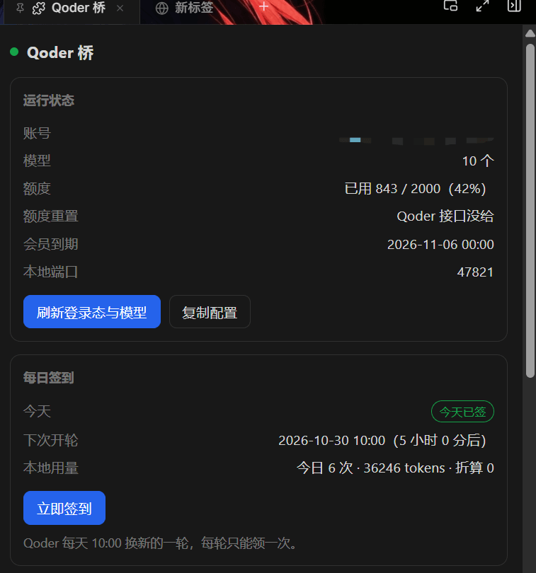
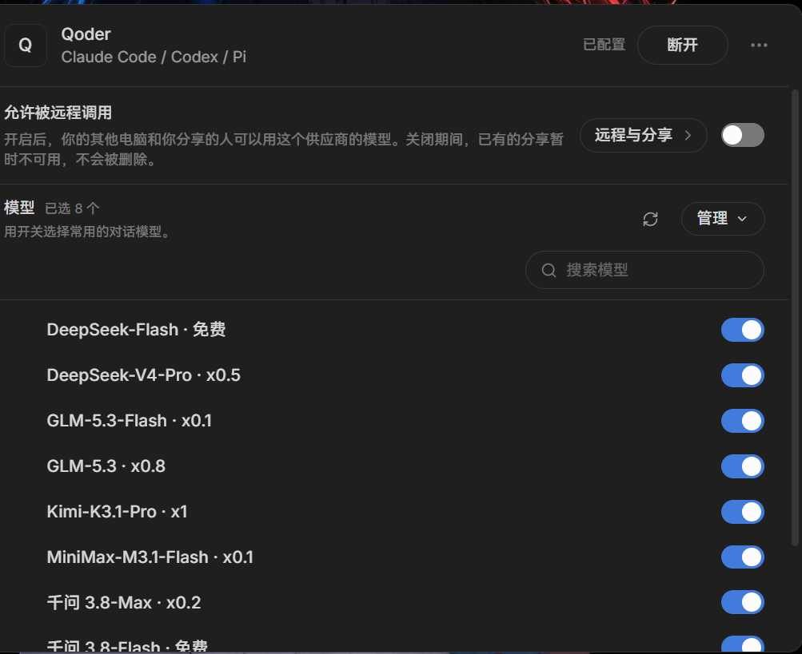

<h1 align="center">cindy-qoder-bridge</h1>

<p align="center"><b>把本机已登录的 Qoder CN 模型接入 Cindy，零配置用你自己的账号额度。</b></p>

<p align="center">
  <a href="README.en.md"><b>English</b></a> · 简体中文
</p>

<p align="center">
  <a href="#安装">安装</a> ·
  <a href="#工作原理">工作原理</a> ·
  <a href="#面板能看什么">面板</a> ·
  <a href="CHANGELOG.md">更新日志</a> ·
  <a href="https://github.com/linvisxie/cindy-qoder-bridge/issues">问题反馈</a>
</p>

<p align="center">
  <a href="https://github.com/linvisxie/cindy-qoder-bridge/releases"></a>
  <a href="LICENSE"></a>
  <a href="https://github.com/linvisxie/cindy-qoder-bridge/stargazers"></a>
  <a href="https://github.com/linvisxie/cindy-qoder-bridge/issues"></a>
  
  
  
</p>

把本机已登录的 **Qoder CN** 模型接入 [Cindy](https://cindy.chat)，
在 Cindy 的模型选择器里直接用你自己的 Qoder 账号额度 —— 不需要 API Key，不需要额外订阅。

插件在 `127.0.0.1:47821` 起一个本地端点，同时讲三种协议（OpenAI Chat / Anthropic Messages / OpenAI Responses），
Cindy 的三个 harness 引擎（`pi` / `claude-code` / `codex`）都能接。

<p align="center">
  
</p>

右侧栏的「Qoder 桥」面板：账号与绿灯、模型数、套餐内额度、会员到期、本地端口，
下面一张独立的「每日签到」卡片 —— 今天签没签、下次开轮是什么时候、今天本地打了多少请求与 token。
「复制配置」一次拷走 Base URL + API Key。

面板只读 Qoder 自己的接口和你本机的账本，**不会**替你自动签到，签到那一下永远要你自己点。

模型名里带倍率（`· 免费` / `· x0.2` / `· x1`），Cindy 的供应商列表能直接看出来哪个便宜：

<p align="center">
  
</p>

## 工作原理

```
Cindy 里的对话
  -> OpenAI Chat / Anthropic Messages / OpenAI Responses 三种协议之一
  -> http://127.0.0.1:47821/v1        本插件起的本地端点（只听 127.0.0.1）
  -> COSY 签名 + Encode 置换           上游不是 OpenAI 兼容端点
  -> https://gateway.qoder.com.cn/     用你自己 Qoder 账号的配额
  -> 双层包装 SSE
  -> 翻回对应协议
```

Qoder 不是 OpenAI 兼容端点，所以需要三样东西：

1. **COSY 签名头** —— 每个网关请求都带 `Cosy-*` 头与 `Authorization: Bearer COSY.<payload>.<sig>`。
2. **置换 base64 请求体** —— 查询串里的 `Encode=1` 表示 JSON 体要先 base64、再按换过的字母表替换、最后三分旋转。
3. **双层 SSE** —— 每个 `data:` 帧是信封对象，它的 `body` 字段本身又是 JSON 字符串。

登录态是每次现从 Qoder CN 客户端目录里的 `auth.v1.dat` 解的（OSCrypt v10 → DPAPI），**只在内存里用，不落盘**。

主要组件：

| 文件 | 角色 |
|---|---|
| `plugin/main.js` | 电子脑：把 AI 的工具调用与面板请求转给 worker |
| `plugin/node/bootstrap.cjs` | 清单 `node.entry`（`node/bootstrap.cjs`）：先取得安装目录与数据目录双锁，再加载全部业务模块 / worker |
| `plugin/node/worker.cjs` | Node 常驻进程：解密登录态、起 HTTP 服务、三条协议路由 |
| `plugin/node/adapters.cjs` | Anthropic / Responses 与 OpenAI Chat 之间的协议翻译 |
| `plugin/node/update.cjs` | 自更新纯函数：版本比较、digest 校验、zip 解包、脚本生成 |
| `plugin/node/download.cjs` | 限制更新下载地址、重定向与包大小 |
| `plugin/node/ownership.cjs` | 安装目录与运行数据目录的 OS 独占所有权 |
| `plugin/node/update-status.cjs` | 更新 journal attempt / result 与中断恢复启动检查 |
| `plugin/panel.*` | 右侧栏面板：账号、额度、签到、模型列表、Base URL / API Key |

它只管理自身插件文件与运行数据，**不直接修改 Cindy 的宿主安装收据或供应商配置**。供应商仍需在 Cindy 界面手动添加；自更新与宿主安装记录的区别见下文。

## 环境依赖（请逐条核对）

| 依赖 | 要求 | 说明 |
|---|---|---|
| 操作系统 | **Windows 10 / 11** | 唯一硬限制。登录态是用 Windows DPAPI（`CryptUnprotectData`，经 PowerShell 调用）解开的，macOS / Linux 上解密这一步过不去，插件起不来。 |
| Cindy 客户端 | **≥ 0.1.119** | 清单里写的就是这个 `minCindyVersion`。更老的版本没有 `custom_providers` 自定义供应商，也没有 node worker。 |
| Qoder CN 客户端 | 已安装并**已登录** | 只支持中国大陆区（客户端 app id `com.qodercn.app.stable`）。国际区（`qoder`）没做——个人版额度常为 0，做了也用不上。 |
| Node.js | **≥ 22**（推荐 24） | 用的是 `fetch`、`AbortSignal.timeout`、`node:readline` 等；worker 跑在 Cindy 自带的那份 Node 里，只有你要跑测试时才需要自己装。 |
| 网络 | 能访问 `gateway.qoder.com.cn` / `openapi.qoder.com.cn` | 走 CN 网络环境。 |
| 磁盘 | ~100 KB | 插件本体；运行数据（日志、用量账本）另算，在 `%APPDATA%\CindyGlobal\qoder-bridge\`。 |

> 不需要 API Key，不需要 OpenAI / Anthropic 账号，不需要额外订阅。用的是你自己 Qoder 账号里已有的配额。

## 安装

### 1. 拿包

从 [Releases](../../releases) 下载 `cindy-qoder-bridge.cindy`，或者自己打一个：

```bat
cd plugin
npm run pack        :: 产出 dist\cindy-qoder-bridge.cindy
```

`.cindy` 就是个 zip（`ghost.json` 在根部），`scripts/pack.cjs` 是零依赖的手写打包器，同样输入产出同样字节。

> **从 0.1.20 起，同一提交在任何时区（UTC / 北京时间）打出的 sha256 相同。** 前提是工作区文件是 LF —— `pack.cjs` 直接读工作区字节，不做换行归一化。
>
> `.gitattributes` 保证正常 `git checkout` 得到 LF，但**如果你用编辑器把某个源文件另存成了 CRLF，本地重打的哈希就会与 Release 不同**。这种情况不是发布包被篡改，只是你的工作区与发布时的字节不一样：`git checkout -- .` 恢复后重打即可对上。核对发布包完整性请直接用 Release 上的 `SHA256SUMS.txt`。

### 2. 装进 Cindy

Cindy → 插件页 → 导入 `.cindy`（也可以直接把文件拖进去）。

首次安装会列权限让你确认。它声明了 **Node 常驻进程** —— 这个能力意味着**能读写你本机文件、能联网**，是读 Qoder 登录态和起本地服务所必需的。装之前请确认你接受这一点。

### 3. 在 Cindy 里加供应商（唯一需要手动做的一步）

装完插件后，右侧栏会出现「Qoder 桥」页签。面板上能看到 **账号 / 模型数 / 额度 / 本地端口 / Base URL / API Key**，有个「复制配置」按钮一次拷走 Base URL + API Key。

然后：**Cindy 设置 → 模型 → 添加自定义供应商**

| 字段 | 填什么 |
|---|---|
| 名称 | 随便，比如 `Qoder` |
| Base URL | `http://127.0.0.1:47821/v1`（以面板显示为准） |
| API Key | 面板上那串 Token，一字不差 |
| 模型 ID | 从面板列表里挑，逐个添加 |

**协议（按引擎选，选错那个引擎就不亮）：**

| Cindy 引擎 | 必须选的协议 |
|---|---|
| `pi` | 任意一个都行 |
| `claude-code` | **Anthropic Messages** |
| `codex` | **OpenAI Responses** |

这是 Cindy 的硬规则（`acceptsWireProtocol`：`claude-code` 只接 `anthropic-messages`、`codex` 只接 `openai-responses`、`pi` 全接）。三条本插件都支持。

模型详情里：

- **上下文上限**：默认报 **1,000,000**（Qoder 官方给的档位是 200K / 400K / 1M，默认档是 200K）。想退回 200K，设环境变量 `CINDY_QODER_CONTEXT=default`。
- **视觉输入**：CN 区模型全部支持，勾上。
- **推理档位**：面板与 `/v1/models` 里都带了（`high` / `max` / `low` 之类），能选的会自己出现。

### 4. 之后

正常启动 Cindy 就行。插件是 `resident`，Cindy 起来自己把 worker 拉到 `47821`；token 持久化在 `state.json`，供应商配置存在 Cindy 自己的数据库里，都不用再管。

**以下情况需要你动手：**

1. Qoder 登录过期 → 在 Qoder CN 客户端重新登录，然后点面板上的「刷新」。
2. `47821` 被别的软件占了 → worker 会顺延到 `47822`…，此时面板显示的 Base URL 变了，要去 Cindy 里改一下。
3. 卸载重装插件 → 供应商要重新填一次。
4. 自更新替换运行文件后 → 用 Cindy 原生导入完整 `.cindy` 包刷新宿主安装记录。

## 面板能看什么

- **登录态**：账号名、绿灯 / 红点
- **额度**：已用 / 总量、附加包额度、额度到期日、会员到期日
- **每日签到**：今天签没签、可领多少 Credits、下一次 10:00 的倒计时，带「立即签到」按钮
- **今日用量**：请求数 / tokens / 折算量（token × 倍率）
- **模型列表**：每个模型的倍率（`· x0.2` / `· 免费`）与推理档位
- **日志**：`bridge.log` 路径，出问题先看它
- **检查更新**：「复制配置」右边那个按钮。点一下查 GitHub Releases，有新版会变成「安装 x.y.z」，再点一次才真装（装完进程会退出重启，所以要点两次）。装的时候先备份整个安装目录到 `<目录>.bak-<旧版本>`，再覆盖文件。

AI 侧也能问：`qoder_status`、`qoder_endpoint`、`qoder_refresh`、`qoder_checkin`、`qoder_update` 五个工具。`qoder_update` 传 `action=apply` 就会下载安装。

## 更新安全与运行边界

- 更新必须提供合法的 **64 位十六进制 SHA-256** 并匹配包内容，不再降级成仅比较 size。下载仅接受本仓库指定 repo / tag / asset 的 GitHub HTTPS 地址；重定向逐跳检查允许域名，最多 5 跳，包上限 32 MiB。
- 安装器等待旧 PID 退出；未退出就停止，不覆盖文件。退出后同样按 `INSTALL_DIR`（`install`）→ `DATA_DIR`（`data`）固定顺序取得 OS 独占锁，并在安装全过程持有双锁。取得双锁后，安装器校验 `latest-attempt.json` 的 attempt 身份；迟到脚本发现指针换代或不存在即拒绝复制。每次更新持久化 journal attempt / result；复制失败尝试回滚，回滚不覆盖 journal，失败保留诊断和 backup。`update-status` 检测到中断的 copy / rollback 会禁止 boot；journal `begin` 与 `applyUpdate` 均禁止覆盖尚未恢复的 attempt 指针，`begin` 拒绝 previous `handed_off`。pending handoff 未确认结果时不能发起新更新，应先检查 `<安装目录>.updates/install.log`，不保证自动重试。
- 持久更新目录统一为 `UPDATE_DIR = canonicalDirectory(INSTALL_DIR) + '.updates'`，即规范化安装目录同级的 `<安装目录>.updates`，不再使用数据目录的 `update/`。bootstrap、worker 与安装器都检查这里的 journal，与 `DATA_DIR` 无关，换数据目录不能绕过，rollback 也不覆盖它。
- **中断恢复需手动处理 journal，原生导入不会自动解除阻断。** Cindy 原生导入完整 `.cindy` 包不会清除安装目录同级的 journal。中断 copy / rollback 失败后，保留所有日志与 backup；通过 Cindy 原生导入完整包并确认成功后，停用插件，将 `<安装目录>.updates/latest-attempt.json` **重命名保留诊断**，再启用插件。不要删除备份和日志。
- **自更新成功仅表示插件运行文件替换成功，不代表 Cindy 的宿主安装记录已刷新。** 不再自动同步宿主安装快照，也不直接写 `ghost-install-state` 安装收据或通过 `process.execPath` 执行同步脚本。Cindy 0.1.128 尚无已验证的公开插件自写收据 API；请通过 **Cindy 插件页原生导入完整 `.cindy` 包**刷新安装记录。
- 清单 `node.entry` 为 `node/bootstrap.cjs`：先按 `INSTALL_DIR`（`install`）→ `DATA_DIR`（`data`）固定顺序取得 OS 独占锁，之后才加载全部业务模块 / worker。Windows 使用命名管道，Linux abstract socket 仅用于 offline CI，不代表支持 Linux 运行插件。**同一安装目录即使数据目录不同也拒绝同时运行；不同端口也不能共享数据目录。多实例的安装目录和数据目录必须都不同。**
- Qoder 凭据读取区分 `valid` / `absent` / `logged-out` / `temporary`，过期按当前时间判断；临时读取失败不等同登出。适配器流中错误使用 worker 的 `formatError` 中文分类，保留已获 usage，并按失败终止，不伪装成正常完成。
- Cindy 0.1.128 通过 `require` 加载 Node entry，已验证与 bootstrap 兼容；这不等于本轮改动已发布或安装。本轮 Windows 故障验证使用真实临时目录，**不是真实插件安装验证**；没有真实用户登录 / 退出测试。测试通过不代表无 bug，也不扩大原有权限。

## 运行数据在哪

| 路径 | 内容 |
|---|---|
| `%APPDATA%\CindyGlobal\owners\<ownerKey>\cindy-brain\_ns\_root\qoder-bridge\` | 插件本体（装的位置，随 Cindy 管理） |
| `%APPDATA%\CindyGlobal\qoder-bridge\state.json` | 本地端点 token + 端口 |
| `%APPDATA%\CindyGlobal\qoder-bridge\models.json` | 模型目录缓存（30 分钟） |
| `%APPDATA%\CindyGlobal\qoder-bridge\usage.json` | 本地用量账本（按天按模型，留 60 天） |
| `<安装目录>.updates/`（`UPDATE_DIR`） | 安装目录同级的持久更新 journal、`latest-attempt.json`、`install.log`、下载包、暂存目录与替换脚本；与数据目录无关 |
| `%APPDATA%\CindyGlobal\qoder-bridge\bridge.log` | 运行日志，超 2 MB 自动滚成 `.1` |

**你的 Qoder token 不会被写进这些文件** —— 每次都是现从 Qoder 客户端目录里的 `auth.v1.dat` 解密，只在内存里用。

环境变量（一般不用改）：

| 变量 | 默认 | 作用 |
|---|---|---|
| `CINDY_QODER_PORT` | `47821` | 首选端口 |
| `CINDY_QODER_DATA` | `%APPDATA%\CindyGlobal\qoder-bridge` | 运行数据目录 |
| `CINDY_QODER_CONTEXT` | （空，报 1M） | 设成 `default` 则报 200K |

## 开发与测试

`test/` 下每个脚本都是独立的、可复跑的判据。多数脚本**需要先装好并登录 Qoder CN**（要真读登录态、真打上游）；纯本地脚本包括 `host-guard`、`responses-status`、`upstream-contract`、`update-chain`、`review-regressions`，以及下列审查回归脚本。没登录时 `features` 与 `e2e-panel` 会把依赖登录态的用例打 `--` / `SKIP` 跳过，不会崩，但那样等于没验到。

```bat
cd plugin && npm run verify     :: 清单静态校验
cd plugin && npm run pack       :: 打包

node test\host-guard.js
node test\responses-status.js
node test\upstream-contract.js
node test\update-chain.js
node test\review-regressions.js
node test\protocol-defaults-reasoning.js :: 协议默认值与 Responses reasoning 回归
node test\bootstrap.js              :: offline：加锁后才加载业务模块
node test\ownership.js              :: 安装目录与数据目录双锁
node test\update-download.js        :: 下载限制
node test\update-install-results.js :: 安装故障与结果记录
node test\update-status.js          :: 更新中断与启动阻断
node test\credential-reading.js     :: 凭据分类与过期
node test\e2e-package.js
node test\e2e-panel.js
node test\e2e-brain.js
node test\smoke-protocols.js
node test\smoke-tools.js
node test\wire-quirks.js
node test\features.js
```

想换模型：`node test\smoke-protocols.js <模型 id>`（默认 `qfmodel`，免费）。
隔离测试使用临时安装副本、临时数据目录与独立端口，不与正在运行的实例共享安装目录或数据目录。`test/bootstrap.js` 登记为 offline，验证双锁取得前不加载业务模块 / worker，以及目录冲突拒绝启动；不需要登录态或真实安装，也不代表真实插件安装验证。

本轮新增 `test/protocol-defaults-reasoning.js`；代码完成，待最终验证，尚未发布 / 安装。测试结果与统计以 `node .github/scripts/ci-run.cjs --mode offline` 及上述单项命令的实际输出为准，不固定断言数；未运行 / SKIP 不等于通过。

### CI 跑哪些、哪些只能在本地跑

云端跑的是上面那些**不需要登录态**的脚本：

```bat
node .github\scripts\ci-run.cjs --mode offline   :: 与 GitHub Actions 同一份编排器
```

`e2e-package`、`e2e-brain`、`smoke-protocols`、`smoke-tools`、`wire-quirks` 必须先登录 Qoder CN、并会真打上游，所以只在开发机上手动跑（`--mode live`），CI 里明确标成「未运行」而不是「通过」。

工作流结构、发布步骤、失败排查见 [docs/CI.md](docs/CI.md)。

**为什么这些测试长这样**：它们都在防具体的线上事故 —— `host-guard` 防 Cindy 的代理转发时把 Host 头改成不带端口（那会让 claude-code 引擎 403）；`wire-quirks` 防 Base URL 带 `/v1` 被叠成 `/v1/v1/messages`、以及上下文选 1M 时 Cindy 把模型 id 编成 `qfmodel[1m]`；`e2e-brain` 防 `cindy.node.request` 的双层信封只剥一层（那会让面板显示「未登录 / 0 个 / —」）；`responses-status` 防 Responses 被截断或内容策略掐断时顶层与子项状态各说各话，也钉死「子项 status 只能是 `in_progress` / `completed` / `incomplete`」——`failed` 只属于顶层 `Response`。

## 本地端点

| 路径 | 鉴权 | 说明 |
|---|---|---|
| `GET /healthz` | 否 | 探活，只回 `{ok, port, modelCount}`。不鉴权，所以只给这三个字段——本地 Token 不放这儿 |
| `GET /status`（`/v1/status` 同义） | 是 | 完整状态：账号、模型、额度、签到、本地用量、日志路径 |
| `GET /v1/models` | 是 | 模型目录（含上下文窗口、倍率、推理档位） |
| `POST /v1/chat/completions` | 是 | OpenAI Chat 协议 |
| `POST /v1/messages`、`POST /v1/messages/count_tokens` | 是 | Anthropic Messages 协议 |
| `POST /v1/responses` | 是 | OpenAI Responses 协议 |

鉴权就是 `Authorization: Bearer <面板上那串 Token>`。

## 已知限制

- **只支持 Windows。** 见上面「环境依赖」。
- **只支持 Qoder CN。** 国际区没做。
- **Cindy 详情页的「报价」修不掉。** 自定义供应商的模型解析器（`parseModelsListResponse`）不读 `displayPricing` / `currency` / `cost` 任何字段，所以那句「该路由没有报价数据」删不掉；倍率只能写在模型名里和面板上。
- **上下文只能报一个数。** Cindy 的供应商模型只认单一数值，所以报了最大档 1M。
- **额度重置时间拿不到。** Qoder 的 `/sash/api/v2/me/usage` 不返回这个字段（实测返回的键里没有），面板会显示「Qoder 接口没给」。
- **依赖 Qoder 的内部接口。** 上游一改，插件就失效。这不是「长期稳定」的东西。
- **本轮协议兼容性行为变更（代码完成，待最终验证，尚未发布 / 安装）**：旧 issue #15（stream 默认值）与 #19（Responses reasoning）同属本轮剩余问题范围，不再暂缓。三协议仅在 `stream === true` 时返回 SSE；缺省或 `false` 返回单个 JSON。上游仍可使用 `stream: true` 再聚合。Responses 流式 / 非流式提供含 `summary_text` 的 reasoning item；流式使用标准 `response.reasoning_summary_part.*` / `response.reasoning_summary_text.*` 事件，只传递真实上游推理内容与 usage，不虚构。依赖旧默认流式行为的调用方需显式传 `stream: true`；尚不能将本轮行为视为已安装版本的能力。

## 免责声明

仅供个人学习研究使用，仅驱动使用者自己的 Qoder 账号在本机调用。使用者需遵守 Qoder 的服务条款，因使用本项目产生的后果由使用者自行承担。本项目与 Qoder、Cindy 均无关联，也未获得其授权或认可。

插件除「每日签到」外的所有请求都是**只读**的；签到是它唯一会对 Qoder 账号产生变更的操作（领取 Qoder 正在向**你自己的账号**发放的额度），它不会自动执行，每次都要手动点击。是否使用它、以及它是否符合 Qoder 当前的服务条款，请自行判断。

具体说清楚风险：

1. **这是逆向实现，不是官方接口。** 请求体里冒充 Qoder CLI 的身份（`session_type: "qodercli"`、`agent_id: "agent_common"` 等）去打它自己的网关。Qoder 的用户协议大概率不允许这类用法。
2. **风险自负。** 可能导致账号被风控、配额被清零、甚至封号。作者不为此承担任何责任，也不提供任何保证。
3. **不要用它做违反上游条款的事**，也不要拿它去绕过计费或配额限制 —— 它没有绕过任何东西，用的就是你自己账号的配额。
4. **登录态只在本机内存里。** 插件不收集、不上传你的 token、聊天内容或任何账号信息。上游账号接口使用 `gateway.qoder.com.cn`、`openapi.qoder.com.cn`；检查更新还访问 GitHub API，下载还访问经允许列表校验的 GitHub Release 域名。
5. `%APPDATA%\CindyGlobal\qoder-bridge\` 里会留运行日志和用量账本，**分享日志前先自己看一眼**。

## 许可

本项目以 **MIT** 发布，见 [LICENSE](LICENSE)。

协议层（COSY 签名、Encode 置换、OSCrypt 解密、消息转换）移植自
[`@eghrhegpe/dsh-connect-qoder`](https://github.com/eghrhegpe/dsh-connect-qoder) 0.7.6（MIT，Copyright (c) 2026 eghrhegpe）。
其版权声明与许可全文见 [THIRD-PARTY-NOTICES.md](THIRD-PARTY-NOTICES.md)，**必须随本项目一起保留**。

「Qoder」「Cindy」等名称与商标归各自所有者，本项目仅作指代使用。
